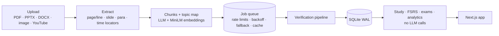
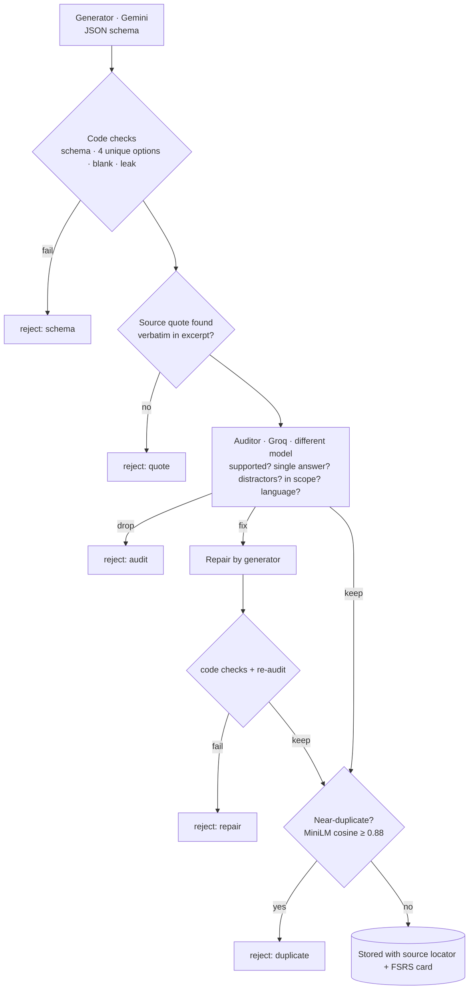

<p align="center">
  
</p>

<h1 align="center">Kavra</h1>

<p align="center"><b>Turn your course notes into a personal exam coach.</b><br/>
Source-grounded questions, FSRS spaced repetition, timed exams — on 100% free LLM tiers.</p>

<p align="center">
  <a href="https://github.com/ruveydayldrm/kavra/actions/workflows/ci.yml"></a>
  
  
  
  
</p>

---

Upload a PDF, slides, a Word file, a photo of your notes or a YouTube lecture. Kavra maps the
topics, writes questions **only from what your material says**, has a *second, different model*
audit every question, and throws away anything whose source it cannot verify. Then it schedules
reviews with FSRS, shows your weak topics and runs timed exam simulations.

## Why it's different

| | Typical "AI quiz" app | Kavra |
|---|---|---|
| Where answers come from | Model's general knowledge | Only the uploaded excerpt; a **verbatim source quote** is required and checked by code |
| Quality control | One model, trust the output | Generate → code checks → **audit by a different model** → repair or drop → dedup |
| "Go to source" | — | Page + line, slide, paragraph or **video timestamp** for every question |
| Scheduling | Random / fixed | **FSRS** (py-fsrs), pure algorithm, no model at study time |
| Open-ended answers | Model grades live (slow, costs quota) | Rubric generated ahead of time; graded **locally and instantly** |
| Bad questions | Stay forever | "This question is wrong" removes it and feeds the quality metrics |
| Cost | Paid API | **$0** — Gemini + Groq free tiers, or fully offline with Ollama |

## Architecture



### Verification pipeline



A question whose source cannot be verified **never reaches the student**: the quote check is
deterministic code, not a model's opinion.

## Quick start

**Requirements:** Python 3.11+, [uv](https://docs.astral.sh/uv/), Node 22+. Optional: [Ollama](https://ollama.com) for offline mode.

### 1. Get free API keys (no credit card)

- **Gemini (generator):** open <https://aistudio.google.com> → sign in → **Get API key** → **Create API key**. Check your per-model limits at <https://aistudio.google.com/rate-limit>.
- **Groq (auditor):** open <https://console.groq.com> → sign up → **API Keys** → **Create API Key** (shown only once). Limits: <https://console.groq.com/settings/limits>.

```bash
cp .env.example .env      # then paste GEMINI_API_KEY and GROQ_API_KEY
```

### 2. Run

```bash
# backend
cd backend
uv sync --extra ml --extra ocr
uv run kavra doctor        # pings every configured provider, never prints keys
uv run kavra serve         # http://127.0.0.1:8000

# frontend (second terminal)
cd frontend
npm install
npm run dev                # http://localhost:3000
```

Windows without `make`: `scripts/tasks.ps1 dev|test|eval`. Docker: `docker compose up` (provided, not tested on the author's machine).

### Offline / private mode

```env
LOCAL_MODE=true
LOCAL_MODEL=qwen2.5:3b     # ollama pull qwen2.5:3b
```

Every role runs on Ollama and nothing leaves your machine. With a single local model the
auditor step becomes a self-review, so quality is lower than the two-model cloud setup.

## Models (checked 2026-11-11)

| Role | Default | Fallbacks |
|---|---|---|
| Generator | `gemini:gemini-3.8-flash` | `gemini:gemini-3.5-flash-lite`, `ollama:qwen2.5:3b` |
| Auditor | `groq:openai/gpt-oss-120b` (strict JSON schema) | `groq:qwen/qwen3.8-27b`, `gemini:gemini-3.5-flash-lite` |
| Eval judge | `groq:qwen/qwen3.8-27b` | — |
| Embeddings | `paraphrase-multilingual-MiniLM-L12-v2` (local) | char n-gram hashing |

The router never lets the auditor be the same provider/model as the generator that produced
the question. Free-tier budgets (RPM / TPM / RPD) are enforced locally from `.env`; a daily
quota error switches to the next provider; everything is cached by `(prompt version, model, prompt)`
so an interrupted run resumes without paying twice.

## Evaluation (`make eval`)

`eval/data` holds four course notes written for this project (TR: cell biology, Newton's laws;
EN: supply & demand, photosynthesis). `eval/run.py` runs them through **single model** vs
**generate + audit** and reports judge-scored validity, source accuracy, clarity, distractor
quality, auditor rejection rate, calls, cost and time. A judge from a third model family scores
the questions; a random sample is exported to `manual_review.csv` for human checking.

<!-- EVAL:START -->
**Open-answer grading vs. labels** (local MiniLM + keyword grader, no LLM, n = 24 TR+EN answers):
MAE **0.15**, Pearson r **0.82**, pass/fail agreement **88%**.
The labels in `eval/labels/open_grading.jsonl` were written by the author's AI assistant; please treat them as a starting set to be reviewed by a human.

The question-generation ablation table needs the free API keys and is filled in by
`make eval` (`--update-readme`). It has not been run yet.
<!-- EVAL:END -->

## Design decisions

- **Calm, premium study UI.** Warm paper background, ink text, one accent (deep teal), amber
  only for streaks, soft red only for errors. Colors are oklch tokens with matching light/dark
  themes. Fraunces (serif display) + Geist (UI) + tabular numbers. No purple AI gradients.
- **Signature interactions.** Card flip on check, a gentle shake on a wrong option and a spring
  on the verdict, progress rings, a GitHub-style activity heatmap, a topic mastery map and a
  streak flame. All motion respects `prefers-reduced-motion`.
- **Keyboard first.** `1–4` choose, `T/F` true/false, `Enter` check/next, `Space` explanation,
  `S` source, `H/E` hard/easy, `R` report, `?` shortcut list.
- **No LLM at study time.** Answers, explanations, rubrics and sources are produced up front, so
  studying is instant and works offline.
- **Ratings stay honest.** Wrong = *Again*; correct defaults to *Good* and you can mark it
  *Hard* or *Easy*. A failed card returns once more within the same session.

## Privacy

On free tiers, Google may use submitted text and outputs to improve its products, and **human
reviewers may read them** (Gemini API terms for unpaid services). Groq's free tier has its own
terms. **Do not upload personal or confidential documents in cloud mode; use `LOCAL_MODE=true`.**
Google allows only paid services for apps offered to users in the EEA, Switzerland or the UK.

## Known limitations

- Free-tier limits are small (Groq's documented example for gpt-oss-120b is 8K TPM), so a
  long PDF takes several minutes and may pause until the daily quota resets. Use **Resume**
  to continue; finished sections are kept.
- YouTube: the original spoken language is detected from caption metadata, with a heuristic
  fallback; some AI-dubbed videos may still pick the wrong track.
- OCR quality depends on the photo; handwriting is weak.
- Single-model local mode is noticeably weaker than the two-model cloud pipeline.
- Single user, no accounts or sync.

## Roadmap

- Fill the eval table with a full cloud run and a human-checked sample
- Export to Anki (.apkg) and import Anki decks
- PWA + offline study on mobile
- Per-question "why this distractor" explanations
- Optional LLM re-grading of open answers in the background

## Project layout

```
backend/   FastAPI · pipeline · FSRS · tests (pytest, fake providers)
frontend/  Next.js 16 · Tailwind v4 · Motion · vitest
eval/      data · labels · run.py
```

## License

MIT © ruveydayldrm

---

<sub>🇹🇷 Kavra, ders notlarından kaynağa bağlı sorular üreten, aralıklı tekrarla ne zaman çalışacağını planlayan ve tamamen ücretsiz çalışan kişisel bir sınav koçudur.</sub>
